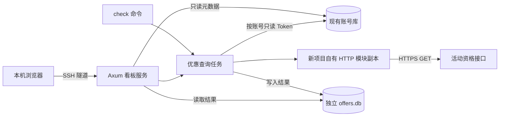

# Sentinel Offers：独立查询程序与账号优惠看板开发设计

版本：v1.1 设计稿——独立项目，复制 HTTP 源码后独立维护
日期：2026-11-02（北京时间）
状态：v1.1 实施说明；实际构建、部署及在线验证结果见 docs/verification.md。

## 1. 方案结论与最小变更

在 `sentinel-rs` 仓库以外建立独立 Rust 项目 `sentinel-offers`。它只读现有账号数据库，通过账号对应的网页 Access Token 查询指定优惠活动，并将查询记录写入自己的 `offers.db`。程序同时提供命令行和内嵌 Web 看板。

**原 `sentinel-rs` 的源码、`Cargo.toml`、`Cargo.lock`、启动脚本、配置和账号表结构均不需要修改。** 新项目拥有自己的源码目录、Cargo manifest、锁文件、构建脚本、HTTP 模块副本、配置、进程和发布目录。

经用户确认，允许将现有 `src/flow/http.rs` 复制一份到新项目的 `backend/src/infrastructure/http.rs`，复制后独立维护。调用的是新项目自己的 `crate::infrastructure::http`，不会通过 `sentinel_rs::flow::http` 引用原项目，不使用 path/git 依赖、软链接、共享源码目录或原项目的 DLL，也不调用原程序的 CLI 或注册函数。

两套程序的唯一业务数据连接为：新工具只读账号库中的 ID、邮箱、状态和 `access_token`。将 `sentinel-rs` 源码和可执行文件移出新工具的构建/运行环境后，只要约定格式的账号库仍存在，新工具仍应可以独立构建和运行。

独立项目以其自身的 `docs/design.md` 作为后续维护入口；原仓库内的聊天设计文档保留本次修订副本，不参与新工具的运行或构建。

| 项目 | 最小方案 |
| --- | --- |
| 新程序 | 一个 `sentinel-offers` 二进制，包含 `check`、`serve`、`export` 子命令 |
| 界面 | HTML/CSS/JavaScript 静态文件，用 `include_str!` 编译进程序 |
| Web 后端 | Axum，只监听 服务器的 `127.0.0.1` |
| 账号来源 | 原 SQLite 的 `accounts` 表，只读 |
| 查询结果 | 新的 `offers.db`，不往原库加表或改字段 |
| 源码复用 | 一次性复制 HTTP 模块并独立维护；无原项目编译或运行依赖 |
| 配置 | 自有 `OFFERS_*` 设置及 `/opt/sentinel-offers/.env`，不读取原 `.env` |
| 调度 | 一个进程同时只执行一个查询批次；账号和活动均顺序处理 |
| 部署 | 独立部署至 `/opt/sentinel-offers`，由现有 `sentinel` 用户运行 |

本期不做注册按钮、账号新增删除、密码管理、登录刷新、补验邮箱、2FA 绑定、优惠兑换、支付、定时巡检、多用户权限或任务断点续跑。没有合格凭据的账号显示原因，查询工具不代替登录工具。

## 2. 账号库数据契约（部署信息已脱敏）

账号库路径由部署方通过 --source-db 显式指定。文档与部署模板中的路径仅为示例，不代表任何真实服务器配置；本节不包含生产账号数量或发布信息。

必需列为 id INTEGER、email TEXT、status TEXT、access_token TEXT。源表可以有其他列，查询工具不会读取密码、Cookie 或 TOTP 字段。没有 refresh_token 依赖。

Token 非空只说明存在已保存的凭据，不能证明当前有效或具有优惠资格。缺 Token 的账号保留在列表中，执行时跳过上游请求。

源库若处于 WAL 模式，应读取真实数据库及其一致的 WAL/SHM 状态，不使用 immutable=1，也不通过只复制主 DB 文件来替代正常访问。账号内容和 schema 由只读连接保护，不改目录权限或数据库模式。

新工具必须有独立启动入口，不复用来源项目的注册脚本。

## 3. 用户操作与本期范围

用户打开看板后，看到原库中的账号列表及已有查询结果。页面刷新只读取本地数据，不自动查询上游。

最小交互为：

1. 查看邮箱、原账号状态、Token 是否存在、免费试用结果、各期限半价结果及查询时间。
2. 选择单个或多个账号，或点击“检测全部账号”。
3. 查看已处理账号数、当前任务状态及每个活动的结果。
4. 按邮箱、免费试用资格、半价资格、待确认状态筛选。
5. 查看失败原因，重新检测选中账号，导出不含凭据的 CSV/JSON。

Token 缺失的账号保留在列表中，结果为“缺少登录凭据”，不发出优惠请求。没有密码输入、Token 显示或 Token 导出按钮。

不做跨平台桌面客户端、React/Vue 构建链、WebSocket、SSE 或浏览器自动化。任务期间页面每 2 秒读取一次本地 API；空闲时每 15 秒刷新本地记录，任何自动刷新均不请求上游活动接口。

## 4. 架构与调用边界



`check` 与 `serve` 是同一二进制的两种运行方式，共用查询和结果模块。它们通过结果目录内的操作系统文件锁保证单实例：服务运行时再启动写入型 `check` 应立即返回“结果库正在使用”，不暗中启动第二批查询。只读 `export` 和 `check --dry-run` 不占写入锁。

CLI 与 Web 共享业务函数，不通过解析终端日志获取进度。任务进度和结果来自 `offers.db`。

源库和结果库路径在启动时解析为绝对路径，禁止二者为同一文件，包括软链接指向同一文件的情况。第一版一个实例只绑定一个源数据库，不支持在网页里输入任意文件路径或上游 URL。

## 5. 文件与依赖改动清单

本地项目位置建议为 `<workspace>/sentinel-offers`，与 `sentinel-rs` 为同级目录，不放入其 Cargo workspace。以下目录全部属于新项目；旧项目没有需要修改的程序文件。

```text
sentinel-offers/
  Cargo.toml / Cargo.lock              独立 workspace 与锁文件
  backend/
    Cargo.toml                        后端包配置
    src/
      main.rs / lib.rs                CLI 与模块入口
      domain/                         活动定义、分类与数据模型
      application/                    参数配置、重试、单任务执行
      infrastructure/                 HTTP 副本、只读源库、结果库、导出
      api/                            Axum 路由与管理鉴权
    migrations/                       结果库 schema
    tests/                            临时库与模拟 HTTP 的离线测试
  frontend/
    index.html / app.js / styles.css   独立桌面 UI，构建时内嵌
    tests/ui-smoke.cjs                 可选桌面浏览器检查
  deploy/
    build.sh / build.ps1               独立构建入口
    install.sh / start                 发布与手动运行入口
    sentinel-offers.service            独立 systemd 服务
    offers.env.example                独立配置示例
  docs/
    design-v1.1.md                     上传的原始设计快照
    design.md                         实施后的设计与目录说明
    source-provenance.md               HTTP 复制来源与适配记录
    operations.md                     构建、使用、停止与回滚
    verification.md                    验证结果与实际限制
```

只复制所需的通用 HTTP 源码，不复制注册、Sentinel VM、邮箱、2FA 或原 Store 的实现。`http.rs` 当前未引用项目内部其他 Rust 模块，适合单文件复制。新项目独立编写只读数据库适配器，不复制整个 `sentinel-rs` 仓库、原 `.env`、账号数据库或构建产物。

在 `backend/tests/` 放置离线测试，响应样例仅使用合成或脱敏数据。复制时记录来源仓库、原文件路径、工作区内容 SHA-256 及日期；来源文件若有未提交修改，不能仅用 Git HEAD 代表实际复制版本。保留原有版权与许可证声明，不擅自给复制代码添加新的授权。

新项目单独选择和锁定依赖，初期 HTTP 库沿用已使用的版本以减少迁移工作；这只是依赖版本选择，不是依赖原项目。下面为关键 manifest 字段示意，其余使用到的依赖在新项目补齐：

```toml
[package]
name = "sentinel-offers"
version = "0.1.0"
edition = "2021"

[dependencies]
axum = "0.8"
tokio = { version = "1", features = ["rt-multi-thread", "macros", "time", "net", "sync", "signal"] }
rusqlite = { version = "0.32", features = ["bundled"] }
wreq = { version = "=0.16.1", features = ["cookies", "gzip", "brotli", "deflate", "socks"] }
wreq-util = "=0.2.0"
fs2 = "0.4"
httpdate = "1"
```

同时按需要独立声明 `anyhow`、`serde`、`serde_json`、`uuid`、`rand`、`dotenvy` 和 `tracing` 等依赖。新项目使用自己的 `Cargo.lock`、`target`、CI 和版本号；不修改、引用或同步原项目的锁文件，不给原项目添加 `offers` feature。

后续发现 HTTP 问题，只修改新项目副本并独立测试发布。上游代码升级不会自动传播到新工具，反之亦然。可以使用同一台机器已安装的 Rust/CMake 编译器，它们是通用开发环境；新项目构建不能执行原项目的脚本或读取原源码。

## 6. 账号读取与凭据处理

### 6.1 只读访问

源库连接使用 `SQLITE_OPEN_READ_ONLY`，再设置 `PRAGMA query_only=ON` 和有限 `busy_timeout`。不存在的源库直接报错，禁止悄悄创建空库。

新项目自行实现源库 reader，不复制或调用原项目的 Store。账号表结构是两个工具之间明确的数据契约；启动时检查必须列及类型，发现不兼容则报错，不尝试替原项目迁移或修复。

列表查询只读取 `id`、`email`、`status` 和 `has_token` 布尔值。实际执行某个账号时，再用参数化 SQL 读取该账号的 Token：

```sql
SELECT id, email, status, access_token
FROM accounts
WHERE id = ?1 AND email = ?2;
```

同时匹配 ID 与邮箱，防止数据库被替换后错误关联同一个数字 ID。任务创建时保存账号 ID、邮箱快照；执行时重新取凭据，不把 Token 快照持久化。

不以 `status = 'registered'` 作为唯一查询条件：原状态可能不能完整反映后续阶段，实际以 Token 是否存在及接口响应为准。`pending_otp` 且 Token 为空则直接跳过。

读取应是短查询，结束后再联网；不能在整个远程请求期间持有源库事务。同步 SQLite 操作放在 `spawn_blocking` 中，每次使用独立连接；不跨 `await` 持有连接或锁。

原库使用 WAL，必须访问真实数据库及对应 WAL 状态，不使用 `immutable=1`，也不能只复制主 `.db` 文件后假定数据完整。SQLite 可能需要访问共享内存等辅助文件；只读保证指“不修改账号数据和 schema”，不是保证不接触任何 SQLite 辅助文件。权限不足时明确报错，不改原目录权限或数据库模式。

### 6.2 Token 边界

Token 只在当前账号查询期间留在后端内存。账号凭据类型不派生 `Serialize` 或会输出内容的 `Debug`；日志、JSON API、CSV 和结果数据库均不包含 Token、密码、Cookie、TOTP 密钥。

不复制原库的合并 Cookie 字符串，不调用登录、注册或 Sentinel challenge 生成。每个账号创建独立 HTTP client / Cookie Jar，避免多个账号之间混用服务端返回的 Cookie。

缺少 Token 显示 `missing_token`；401 显示 `auth_required`。401 只能说明该次请求认证未通过，不能直接断定账号被封或仅仅是 Token 过期。首版不尝试自动修复凭据。

## 7. 活动查询协议与判断规则

### 7.1 初始活动范围

第一版内置四个活动，标识在 `backend/src/domain/campaign.rs` 单独集中定义。先不开发活动配置编辑器；以后增加活动只需调整定义和对应测试。

| 业务维度 | 活动标识 |
| --- | --- |
| 免费一个月 | `plus-1-month-free` |
| 半价一个月 | `plus-1-month-50-pct-off` |
| 半价两个月 | `plus-2-months-50-pct-off` |
| 半价三个月 | `plus-3-months-50-pct-off` |

请求为已观察到的网页内部接口：

```http
GET https://chatgpt.com/backend-api/promo_campaign/check_coupon?coupon=<活动标识>&is_coupon_from_query_param=true
Authorization: Bearer <账号网页 access_token>
Accept: application/json
Origin: https://chatgpt.com
Referer: https://chatgpt.com/
```

它不是稳定的公共 API 契约。上述活动与响应字段来自公开项目，本文未验证它们在当前账号、地区、时间下仍然开放。实施时先用一个已有有效 Token 的账号核对响应形态，再决定是否调整解析器。接口失败不能触发浏览器绕过、重新注册或自动兑换。

最小版本不增加独立的“账号验活”上游请求：优惠请求本身记录认证失败；额外账号接口可留待确有需求时添加。

### 7.2 每个活动的状态

请求执行状态与优惠结论分开保存。查询完成不等于符合资格。

| 观察结果 | `eligibility` | `reason` 或处理 |
| --- | --- | --- |
| 200、JSON 结构符合已验证契约、coupon 匹配、`state=eligible` | `eligible` | 已确认有资格 |
| 200、同上且 `state=not_eligible` | `not_eligible` | 已确认无资格 |
| Token 为空或账号已不存在 | `unknown` | `missing_token` / `account_missing`，不请求 |
| Token 格式无法安全放入请求头 | `unknown` | `invalid_token_format`，不输出原值 |
| 401 | `unknown` | `auth_required`，本账号剩余活动不再请求 |
| 403 | `unknown` | `access_denied`，不认定账号被封或无优惠 |
| 429 | `unknown` 或稍后重试 | `rate_limited`，按退避规则处理 |
| 5xx、连接错误、超时 | `unknown` 或稍后重试 | 对应错误分类 |
| 200 但 `state=offline` | `unknown` | `upstream_offline`，不解释为活动下线或无资格 |
| 3xx、其他 4xx、非 JSON、缺字段、coupon 不匹配或新状态 | `unknown` | `unexpected_response` / `invalid_response` |

如响应带已兑换状态，可以单独展示经验证的 `redemption_status`；不把未知的兑换字段组合推断成“可领取”。查询“符合资格”也不表示已经兑换成功或将来一定能兑换。

### 7.3 半价聚合与历史结果

免费试用维度只对应第一张活动券。半价维度对应后三张：

- 任意一张明确 `eligible`：半价维度为“有”，并列出已确认的期限；其余未确认期限继续显示“未知”。
- 三张都明确 `not_eligible`：半价维度为“无”。
- 其他组合：半价维度为“待确认”。

聚合只使用同一账号最近一次任务的记录，不将不同时间的三张结果混成一次完整检查。另保留每张券最后一次可信结论：新查询失败时可显示“本次待确认；上次符合，时间 …”，不能把旧结论冒充本次结论。

未检测、排队中、查询中与已完成但未知要分别显示。所有已知结论都附检查时间；不承诺有效期，不用一个不透明的“账号正常/异常”状态代替四张券的证据。

### 7.4 HTTP 副本适配与重试

使用新项目 `src/http.rs` 中的 `Client`、`RequestSpec::get()` 和 `HttpResponse`。这些类型来自源码复制后的本地模块，不是原注册项目的 crate。每次运行都会创建本进程自己的连接池、Cookie Jar 和重试状态；没有跨进程客户端实例或 Cookie 共享。

复制的第一份文件先保存内容哈希以便比对；在新项目独立适配后再接入运行入口。保留正常 TLS 校验和代理支持，客户端只读取新工具自己的配置。可保留现有类型与函数名以减少修改量，原注册代码不参与编译。

查询模块创建本地 client 时传 `wreq::retry::Policy::never()`，关闭客户端内部重试，由查询模块统一处理，避免内外重试次数相乘。

默认每次请求外包 `tokio::time::timeout(20 秒, ...)`；账号和活动顺序执行，每两个上游请求至少间隔 1 秒。每个活动最多尝试 3 次，包含首次。

网络错误、超时和 5xx 使用 1 秒、2 秒退避。429 解析 `Retry-After` 的秒数或 HTTP 日期；有效等待不超过 60 秒时遵循该等待并计入次数预算。等待超过 60 秒或连续 429 耗尽重试预算时结束当前批次，剩余条目记为 `deferred_rate_limit`，记录可重试时间，不换 IP 或立即继续打剩余账号。没有 `Retry-After` 时使用 5 秒、10 秒退避。

因限流结束的任务记为 `interrupted`，`stop_reason=deferred_rate_limit`。有效的未来 `retry_after_at` 同时约束新任务创建，CLI 和 API 都不能在该时间前重新发起请求；API 返回 429 和剩余等待时间。没有服务端时间且重试已耗尽时，设置 60 秒本地冷却。

原 HTTP 文件有基于 `SENTINEL_LOG` 打印响应正文、错误中拼入 header 值和敏感 header 仅遮蔽一部分的行为。既然采用副本，新项目可以直接修正副本，具体要求是：

1. 删除原始响应正文输出分支；日志使用 `OFFERS_LOG` 和结构化事件。凭据与正文不得因切换 debug/trace 而输出。
2. 将 TLS emulation 设置改为自有配置，例如 `OFFERS_HTTP_EMULATION`；移除对 `SENTINEL_*`、`TURB_WREQ_EMULATION` 的读取。
3. Header 解析失败只报告字段名称和固定错误分类，不拼入 header 值；敏感 header 全量脱敏，不显示其前缀。Request/Response 的调试输出同样不能包含凭据或正文。
4. JSON 解析失败不把正文追加到错误链；发送错误经查询层分类后再记录，不直接透传整个对象。
5. Token 放入请求头前检查大小和可打印 ASCII，拒绝换行、控制字符及空白分隔；测试输入故意构造无效 Token 以验证无泄漏。

所有适配只编辑新项目的 `backend/src/infrastructure/http.rs`。原 `src/flow/http.rs` 内容保持原样，也不需要改原项目的日志环境变量。

## 8. 独立结果数据库

默认建议路径为 `/var/lib/sentinel-offers/offers.db`，使用 WAL、外键、有限 busy timeout 和短事务。使用同目录 `offers.lock` 的 OS 独占锁；崩溃后由 OS 释放，不能仅凭“锁文件存在”认定仍在运行。

最小 schema 包括三张表，不复制一份完整账号库：

| 表 | 字段与作用 |
| --- | --- |
| `offer_meta` | `key`、`value`；只管理本工具的 schema 版本 |
| `offer_tasks` | `task_id`、`source_key`、`status`、`created_at`、`started_at`、`finished_at`、`stop_reason`、`retry_after_at`；保存任务生命周期 |
| `offer_checks` | `task_id`、`account_id`、`email`、`coupon`、`execution_status`、`eligibility`、`reason`、`http_status`、`upstream_state`、`attempts`、`checked_at`、`redemption_status`；每个账号每张券一行 |

ID、邮箱、状态和活动标识使用 TEXT，源账号数字 ID、HTTP 状态码、次数和 Unix 秒时间使用 INTEGER；尚无值的时间、HTTP 状态和结论允许 NULL。`offer_tasks.task_id` 为主键；`offer_checks.task_id` 外键引用它。建立 `(source_key, created_at)` 任务索引以及 `(account_id, email, coupon, checked_at)` 检查记录索引。状态值用 CHECK 约束；`upstream_state` 和兑换状态只保存经长度限制的枚举值，不接受任意长字符串。

`source_key` 是规范化后的源库绝对路径。检查记录使用 `(task_id, account_id, email, coupon)` 唯一键；历史查找按源库、账号 ID、邮箱、coupon 和任务创建时间定位。源库记录被删除时，不把历史记录作为仍存在的账号重新展示。

任务创建时在一个短事务内插入账号快照对应的四张券记录，初始 `pending`。开始执行更新为 `running`；完成或跳过后为 `finished`。待执行记录的 `eligibility` 为 NULL；完成但无法确认则为 `unknown`。不得将 NULL 当作 `not_eligible`。

任务状态为 `queued → running → completed / interrupted / failed`。`completed` 仅表示全部条目已处理，可能包含认证错误或未知结论；`failed` 用于结果库写入失败等任务级故障。

已完成账号数由“四张券均为终态”的账号数量计算，避免账户数和请求数混淆。每张券记录提交后即可在 UI 中看到；不要等整批结束才保存。

启动时获得独占锁后，将之前遗留的 `queued/running` 任务标记为 `interrupted`，未完成条目记 `interrupted`。已经保存的结果保留，不自动续跑。用户可重新选择账号发起一个新任务。

正常 SIGTERM/Ctrl+C 时停止接受任务、停止发送下一条上游请求，取消当前请求并持久化中断状态后退出；设置退出上限，超时交由下次启动恢复。浏览器关闭或刷新不取消后台任务。第一版不提供网页暂停/恢复按钮。结果库写入失败时停止继续查询，只记录不含凭据的进程错误；能写回时标记 `failed`，不能写回时由重启恢复标记中断。

保存严格允许字段，不存原始请求头、原始响应正文或完整 Token。schema 只在结果库初始化；遇到高于程序支持的版本拒绝写入，不自动降级。

## 9. 配置与命令行设计

### 9.1 配置优先级

通用优先级：命令行参数 > 进程环境变量 > 显式指定的 env 文件 > 默认值。源库路径与结果库路径必须显式提供，避免工作目录变化时误读另一个数据库。

| 参数或配置 | 作用 |
| --- | --- |
| `--source-db` | 现有账号库绝对路径 |
| `--results-db` | 本工具结果库绝对路径 |
| `--env-file` | 可选读取新工具自己的 `/opt/sentinel-offers/.env`，不执行 shell 代码 |
| `--proxy` / `OFFERS_PROXY` | 新工具自己的代理设置；不自动读取注册项目代理或系统代理 |
| `OFFERS_HTTP_EMULATION` / `OFFERS_LOG` | 新工具自己的 TLS 配置与脱敏日志级别 |
| `--direct` | 明确直连，与 `--proxy` 冲突；不在代理失败时自动直连 |
| `--listen` | serve 默认 `127.0.0.1:8787`；首版拒绝非回环监听 |
| `--admin-token-file` | 看板管理口令文件，默认在结果库目录的 `admin.token` |

只读入新工具的设置，不加载 `/opt/sentinel-rs/.env`，不继承 `SENTINEL_*`、`TURB_*`、`HTTP_PROXY`、`HTTPS_PROXY`、`ALL_PROXY` 的隐式行为。需要代理时单独配置 `OFFERS_PROXY`，没有指定则明示直连；代理失败不回退直连。不需要配置邮箱 API、注册参数或 2FA。

代理可以人为配置为同一个服务，但两个配置文件互不读取、不会随另一方修改而自动变化。默认独立代理配置更便于分别控制上游流量。

### 9.2 拟定使用命令

**以下是开发完成后的拟定命令，不是当前已经可执行的功能。**

```bash
# 离线预览：校验库结构和选中账号，不联网，不写结果，不输出凭据
sentinel-offers check \
  --source-db /var/lib/sentinel-rs/sentinel-rs.db \
  --results-db /var/lib/sentinel-offers/offers.db \
  --all --dry-run

# 手动检测全部账号
sentinel-offers check \
  --source-db /var/lib/sentinel-rs/sentinel-rs.db \
  --results-db /var/lib/sentinel-offers/offers.db \
  --env-file /opt/sentinel-offers/.env --all

# 指定账号；可以重复 --account-id
sentinel-offers check \
  --source-db /var/lib/sentinel-rs/sentinel-rs.db \
  --results-db /var/lib/sentinel-offers/offers.db \
  --env-file /opt/sentinel-offers/.env --account-id 123

# 启动看板；不因启动而自动发起检测
sentinel-offers serve \
  --source-db /var/lib/sentinel-rs/sentinel-rs.db \
  --results-db /var/lib/sentinel-offers/offers.db \
  --env-file /opt/sentinel-offers/.env --listen 127.0.0.1:8787
```

`check` 必须指定 `--all` 或至少一个 `--account-id`，无参数只显示帮助。`--all` 和 ID 列表互斥。`export` 按任务 ID 从结果库生成 CSV/JSON，不读取 Token，不触发检测。

```bash
sentinel-offers export \
  --results-db /var/lib/sentinel-offers/offers.db \
  --task-id <任务ID> --format csv --output /tmp/offers-report.csv
```

导出文件以仅当前用户可读写的权限创建；目标已存在时默认报错，显式 `--overwrite` 才允许覆盖。

CLI 检测退出码：0 = 所有目标均得到可判断结论；2 = 任务处理完但包含缺凭据、未知或中断；1 = 配置、权限、数据库等任务级错误。“明确无资格”仍属于成功完成查询，不应返回运行错误。

## 10. 看板 API 与页面

### 10.1 API 最小集合

所有 `/api/*` 路由要求管理口令，不支持 CORS。静态页面不包含账号或配置数据。

| 方法 | 路径 | 行为 |
| --- | --- | --- |
| GET | `/api/accounts` | 源库账号元数据与最近任务结果；邮箱搜索、分页和资格筛选 |
| GET | `/api/accounts/{id}/offers` | 四张券的最新记录、上次可信结论及时间 |
| POST | `/api/tasks` | 选中 ID 或全部账号创建一个检测任务 |
| GET | `/api/tasks` | 最近任务列表及唯一活动任务 |
| GET | `/api/tasks/{id}` | 任务进度、结果计数、结束原因 |
| GET | `/api/tasks/{id}/export?format=csv` | 导出指定任务结果，format 也支持 json |

POST 示例：

```json
{"scope":"selected","account_ids":[1,2,3]}
```

成功返回 `202` 和 `task_id`；已有任务时返回 `409 task_busy`，不会排第二个批次。全量查询使用 `{"scope":"all"}`，服务端在创建时固定账号集合；执行期间新注册的账号下次再查。

接口采用专用 DTO，不将数据库凭据结构整体序列化。分页默认 50、上限 200；对 ID 数量、请求体和筛选枚举做明确校验。结果错误使用固定代码和简短说明，不透传原始上游正文。

### 10.2 页面内容

一个主页面即可：顶部为总账号数、Token 缺失数、免费试用符合数、半价符合数、待确认数；中部为搜索与筛选；下方为账号表格和当前任务进度。

免费与半价计数可能重叠，不能相加当作总账号数。统计口径是全库当前账号的最新任务结果；待确认包含未检测、缺凭据、正在检测或任一维度尚未确认，文案需明确。

表格列：选择框、邮箱、原账号状态、凭据状态、免费一个月、半价一个月、半价两个月、半价三个月、最近检查时间、结果详情。显示原库 `status` 时标为“注册记录状态”，不把它解释成实时登录状态。

筛选“有半价”包含已确认至少一个期限符合的账号；详情仍显示其他期限是否未知。最近失败保留旧可信结论的时间说明。所有动态文本通过 `textContent` 等安全方式渲染，不拼接成 HTML。

数据时间以 UTC Unix 秒保存，页面以浏览器本地时区显示，并标明时区；CSV/JSON 使用带时区的 ISO 8601。导出采用正确 CSV 引号规则，并处理以 `= + - @` 等开头的单元格，避免表格公式被执行。

### 10.3 服务器访问方式

首版只通过 SSH 隧道使用，不开放公网业务端口：

```powershell
ssh -N -L 8787:127.0.0.1:8787 offers-host
```

服务启动后在本机打开 `http://127.0.0.1:8787`。程序首次初始化生成随机管理口令，存放于 `admin.token`，文件权限 0600，不写日志。用户在页面输入管理口令，前端只在内存保存，通过 Authorization 请求头访问 API；页面刷新后重新输入。

服务校验 Host 和浏览器 Origin，拒绝跨站 API 请求；不接受 URL 查询参数里的管理口令。页面不加载 CDN 脚本，设置 CSP 和 `Cache-Control: no-store`。这只是一套单人管理入口，不实现用户账号系统。

## 11. 构建与部署

开发在新的 `<workspace>/sentinel-offers` 目录进行；服务器部署在 `/opt/sentinel-offers`，不编辑原项目的活动 release。新项目生成和提交自己的锁文件，之后以 `--locked` 构建。

新项目自有 `deploy/build.ps1` / `deploy/build.sh` 准备 BoringSSL 等构建条件并调用 Cargo，脚本不能调用 `../sentinel-rs/build.*` 或读取原 Cargo 配置。准备好环境后的等价构建命令如下，在新项目根目录执行：

```text
cargo build --release --locked
cargo test --locked
```

复制 HTTP 源码后使用的 `wreq / BoringSSL` 仍有 C/C++、CMake、Ninja、libclang 等原生构建要求，新项目独立声明并准备这些条件。Windows 需要的运行时文件随新程序打包；Linux 在目标兼容环境编译，不依赖原程序目录中的 DLL、so 或可执行文件。

部署布局建议：

```text
/opt/sentinel-offers/releases/<版本>/bin/sentinel-offers
/opt/sentinel-offers/current -> releases/<版本>
/opt/sentinel-offers/.env
/var/lib/sentinel-offers/offers.db
/var/lib/sentinel-offers/offers.lock
/var/lib/sentinel-offers/admin.token
```

新数据目录归属 `sentinel:sentinel`、权限 0700，进程 umask 0077。使用同一 OS 用户可读取现有源库，无需放宽原库权限；源库写入约束由只读连接与测试保证，不能宣称该用户从操作系统层面完全没有写权限。

`sentinel-offers.service` 只启动新二进制的 `serve` 子命令，设置 `User=sentinel`、`Group=sentinel`、明确的源库/结果库/自有配置路径、回环监听及 `Restart=on-failure`。不设置对注册服务的启动依赖，也不启动或停止原进程。注册入口、原二进制、原 `current` 链接不随查询工具升级而替换。

上线顺序：完成离线测试 → 构建新程序 → 创建新部署与数据目录 → 离线检查账号读取 → 用一个已有账号校验活动响应 → 启动看板 → 逐步执行所选账号查询。缺 Token 的记录应可见且不产生上游请求。

回滚时停止新服务并切回其上一版本，保留结果库；原注册项目无需回滚。若 schema 已超出旧版本支持范围，应先停止并使用兼容备份恢复结果库，不能让旧程序强行降级。SQLite 备份使用备份 API 或停止写入并完成检查点，不在运行时仅拷贝主 DB 文件。

## 12. 与现有代码的影响评估

| 位置 | 本期处理 | 影响 |
| --- | --- | --- |
| `src/main.rs` | 不修改 | 原 `mint/register` 参数和行为保留 |
| `src/lib.rs` | 不引用、不修改 | 新程序有自己的模块边界 |
| `src/flow/mod.rs` | 不修改 | 注册、邮箱验证、2FA 流程不接入新看板 |
| `src/flow/http.rs` | 仅作为一次性复制来源 | HTTP 修改仅发生在新项目副本 |
| `src/flow/store.rs` | 不调用其写入入口 | 新建只读源库适配器 |
| 原 `accounts` / `email_pool` / `schema_meta` | 不迁移、不更新 | 优惠结果与账号数据分离 |
| `start.sh` / `start.ps1` / 服务器 原 start | 不修改 | 防止看板启动意外变成真实注册 |
| 原 `Cargo.toml` / `Cargo.lock` / `target` | 不读取、不修改 | 新工具独立依赖解析和编译，不改变注册构建图 |
| 原 `.env` 与进程环境 | 不读取、不修改 | 新工具独立配置代理和日志 |
| 服务器资源 | 新常驻轻量进程 | 有额外内存、文件句柄和网络流量，不承诺零资源影响 |

此前发现的 2FA 激活结果缺少校验，是注册项目的独立问题，不是优惠查询功能的前置依赖。本期看板不把已保存 TOTP 密钥解释为服务器确认绑定成功。

独立项目可以保证没有注册代码或构建依赖上的耦合，但仍有共享资源：两者读取同一数据库文件，运行在同一台服务器，且可能访问相同账号或出口。短只读查询、WAL、请求间隔和独立进程限额用于控制影响；不能承诺额外查询绝不会引起 I/O 竞争或上游限流。不会修改 Token、主动退出登录或重复设置账号。

## 13. 测试与验收

离线测试使用合成 Token 和临时数据库，不触碰真实账号。测试覆盖行为边界，重点如下：

| 测试 | 必须证明 |
| --- | --- |
| 原库只读 | 对只读连接执行 INSERT/UPDATE/DDL 失败；运行前后源库逻辑数据和 schema 一致 |
| WAL 并行读取 | 原程序模拟写入时能读取已提交数据；不长期持锁、不读错误的副本 |
| 数据库路径 | 缺失源库不会创建文件；源库与结果库指向同一文件时拒绝启动 |
| 活动分类 | 免费、三种半价、部分成功、全部否定及未知组合符合聚合规则 |
| 响应异常 | 401/403/429/5xx、超时、offline、非 JSON、未知 state 和 coupon 不匹配不误报“无优惠” |
| 重试预算 | 总尝试不超过 3 次；Retry-After 生效；长限流停止批次而非继续扫剩余账号 |
| 凭据隔离 | 缺 Token 不请求；不同账号 client/Cookie Jar 隔离；秘密不出现在日志、API 或导出 |
| 任务并发 | UI 重复提交返回 409；CLI 与 serve 竞争写锁时只有一个成功 |
| 中断恢复 | 重启保留已写结果，将未完成任务标记中断，不自动重复发请求 |
| UI 与 API | 无口令及跨站请求被拒；搜索、分页、筛选、进度与导出正确 |
| 源码独立 | 在无法访问 sentinel-rs 源码和可执行文件的干净环境构建新项目；无 path/git 依赖、软链接或运行时调用 |
| 原项目未改动 | 新项目开发前后原 HTTP 源码、Cargo 配置、锁文件、脚本及配置内容一致；保护原有未提交修改 |
| 配置独立 | 设置 SENTINEL_*、TURB_* 和系统代理变量不会改变新工具行为；只有 OFFERS_* 和显式参数生效 |

HTTP 行为测试通过可注入的请求执行接口返回模拟响应，不为测试而允许生产界面输入任意上游地址。对重试使用可控时钟或测试 sleep 接口，不让测试真实等待几十秒。

实施阶段的在线验证只检查资格：选择已有 Token 的一个账号，核对真实响应、界面结果和错误分类，不调用注册、兑换、结账或绑定接口。未通过这一步，只能交付“离线行为验证通过”，不能声称当前活动可用。

完成标准：

1. 两种程序独立启动，启动看板不会执行注册或自动开始优惠查询。
2. 能从 服务器 原库列出账号，缺凭据有明确原因，原库逻辑数据和 schema 不被修改。
3. 四个活动分别记录证据；未知、历史结果和本次结果区分清楚。
4. 页面可以完成选择、检测、查看进度、筛选和导出；管理接口不泄露账号凭据。
5. 有明确的查询接口兼容性实测结论，以及独立部署、停止和回滚说明。
6. 停止或移走原注册程序后，新工具仍能基于约定账号库工作；停止新工具不影响原注册程序启动。此验证使用隔离环境，不操作线上注册进程。

## 14. 实施顺序与尚待验证项

建议分三步完成，每一步都产出可用结果：

| 阶段 | 交付物 |
| --- | --- |
| A：查询核心 | 独立 Cargo 项目、HTTP 副本适配、只读源库、四个活动解析器、独立结果库、check/export 命令、离线测试 |
| B：看板 | Axum、内嵌页面、单任务进度、筛选与管理口令 |
| C：服务器发布 | 独立部署目录与配置、单账号在线验证、操作说明、源码独立与原项目未改动检查 |

必须保持可见的未知事项：活动是否仍开放；服务器当前出口能否访问接口；Token 是否有效；响应结构是否与参考项目一致。这些影响查询结果的可信度，不能用“源码存在”代替实测，也不应通过扩大到注册、登录或支付流程来掩盖问题。

## 15. 依据

- 本地 `src/flow/store.rs`：账号表结构、写入型 Store、完整字段 upsert 行为。
- 本地 `src/flow/http.rs`：经用户允许作为一次性 HTTP 源码复制来源；具体内容以来源记录中的 SHA-256 为准。
- 本地 `src/flow/mod.rs`：网页会话 Token 获取与注册步骤。
- 服务器只读检查：2026-11-02，本文第 2 节列明的路径、权限和数据快照。
- [chatgpt-plus-trial-checker/server.js](https://github.com/Zhu-junwei/chatgpt-plus-trial-checker/blob/main/server.js)：单活动纯 HTTP 查询参考。
- [chatgpt-account-keeper/src/promoEligibility.js](https://github.com/yang-sanmu/chatgpt-account-keeper/blob/main/src/promoEligibility.js)：四个活动标识、响应判断与部分结果处理参考。

上述两个 GitHub 查询项目只作为协议观察资料，不直接搬运其实现；本机 `sentinel-rs` 的 HTTP 文件则按用户明确允许进行源码复制，记录来源并独立维护。第三方项目的实现与说明均不代表 OpenAI 对内部接口或活动有效性的保证。

实施补充：用户要求仅桌面 UI；frontend 使用电脑端布局，不实现手机或平板响应式分支。

## 16. 0.1.1 代理设置补充

桌面看板新增可展开的“查询代理”设置区，填写代理后显式保存，或选择直连。`GET /api/settings/proxy` 返回当前模式、来源和脱敏地址；`PUT /api/settings/proxy` 接收 `{"mode":"proxy","proxy":"http://example.invalid:8080"}` 或 `{"mode":"direct"}`。均沿用管理口令、Host/Origin 校验与禁止缓存规则。

设置保存在现有 `offer_meta` 表的 `query_proxy` 键：键缺失使用启动默认值，空字符串表示显式直连，其他值是格式校验后的代理。无需迁移现有任务和活动表，不修改源账号库。代理凭据只保存在私有结果库内，API 不返回用户名、密码，也不写入任务导出或日志。

每批任务在创建前读取一次有效配置并固定快照，每个账号仍单独建立客户端与 Cookie Jar。修改设置只影响下一批；代理错误不回退直连。保存设置不探测网络、不创建检测任务。CLI `check` 显式 `--proxy` / `--direct` 高于看板配置，其余情况由看板已保存值覆盖启动默认值。具体优先级及服务器代理地址说明见操作手册。

旧版 0.1.0 可以继续读取本版结果库，但会忽略此键；回滚旧二进制时应在其独立启动配置中明确设置所需出口。重新登录能力本次不实现，来源项目保持原有职责。
